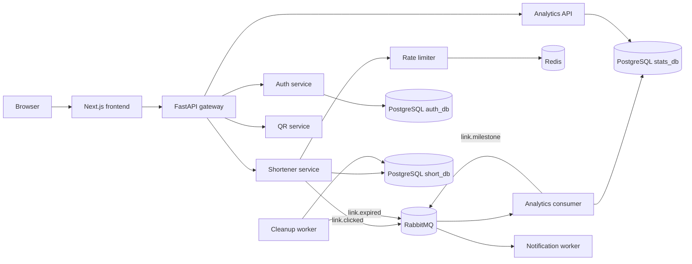

# WispURL

WispURL is a URL shortener and analytics application built from independently deployable services. Users create and manage short links, redirect through short codes, and view aggregate click analytics. The application is also a portfolio project for building a production-style DevOps, DevSecOps, and SRE platform around a real service.

The local Docker Compose application and its security and observability tooling are under active development. The AWS cloud work is currently an implementation plan; this repository does not yet provision AWS infrastructure or deploy to EKS. See the [local epic](docs/local/EPIC.md) and [cloud epic](docs/cloud/EPIC.md) for the ordered work and completion status.

## What the application does

- Creates short links using generated base62 codes or a user-selected slug, with optional expiration.
- Redirects visitors to the original URL and publishes click events asynchronously.
- Provides account authentication and an authenticated link-management and analytics dashboard.
- Aggregates click counts, daily activity, and top referrers while anonymizing IP addresses before storage.
- Generates QR code images for links.
- Applies per-user and per-action rate limits using Redis.
- Sends expiration and click-milestone notifications; local development logs notifications by default.

## Architecture



The gateway is the intended public API entry point. PostgreSQL runs as one local server with separate databases for Auth, Shortener, and Analytics; services own their respective database and do not share tables or cross-service foreign keys. RabbitMQ carries click and lifecycle events so a broker or analytics outage does not need to block a redirect. JWTs are verified locally by services instead of requiring an Auth service call for every request.

### Services

| Component | Role | Data or responsibility |
| --- | --- | --- |
| [frontend](frontend/README.md) | Web application | Next.js marketing pages, authentication flows, and dashboard |
| [gateway](gateway/README.md) | Public API gateway | Routes public requests and applies shared request/security controls |
| [auth-service](auth-service/README.md) | HTTP API | Signup, login, refresh, logout, and `auth_db` ownership |
| [shortener-service](shortener-service/README.md) | HTTP API and event producer | Link lifecycle, redirects, `short_db`, and click-event publishing |
| [analytics-service](analytics-service/README.md) | Internal HTTP API | Event ingestion and aggregate statistics in `stats_db` |
| Analytics consumer | Queue worker | Consumes click events, writes analytics, and emits milestone events |
| [rate-limiter-service](rate-limiter-service/README.md) | Internal HTTP API | Atomic per-user limits backed by Redis |
| [qr-service](qr-service/README.md) | HTTP API | Stateless PNG QR generation |
| [cleanup-service](cleanup-service/README.md) | Scheduled worker | Deactivates expired links and publishes expiration events |
| [notification-service](notification-service/README.md) | Queue worker | Handles expiration and milestone notifications |

More implementation and configuration detail is available in the service READMEs.

## Technology

- **Backend:** Python 3.13, FastAPI, async SQLAlchemy, Pydantic Settings, structlog, Gunicorn/Uvicorn, and `uv`.
- **Data and messaging:** PostgreSQL, Alembic, Redis, RabbitMQ, and `aio-pika`.
- **Frontend:** Next.js, React, TypeScript, Tailwind CSS, TanStack Query, and Recharts.
- **Local secrets:** HashiCorp Vault with Raft storage, local TLS, and scripted initialization/unsealing.
- **Local observability:** Prometheus, Loki, Tempo, and Grafana Alloy. Grafana is not yet included in the local Compose stack.
- **Developer security:** Gitleaks and pre-commit.
- **Planned cloud platform:** AWS, EKS, ArgoCD, AWS Secrets Manager, Terraform, and GitHub Actions with OIDC.

## Run the local application

### Requirements

- Docker with the Compose v2 plugin, with the Docker daemon running.
- GNU Make.
- OpenSSL for generating local Vault certificates.
- Gitleaks and pre-commit for the developer hook setup. `make setup` can install them through Homebrew where available; on Linux, install Gitleaks first if the Makefile reports it is missing.
- `uv` and Node.js/npm only if you plan to run a Python service or the frontend directly on the host.

### 1. Configure local values

Copy the example file and replace its secret placeholders before bootstrapping Vault:

```sh
cp .env.example .env
openssl rand -hex 32
```

Generate separate random values and set at least `JWT_SECRET`, `INTERNAL_API_KEY`, and `POSTGRES_PASSWORD` in `.env`. Use the generated PostgreSQL password in all three database URLs. Set `RABBITMQ_DEFAULT_PASS` and make `RABBITMQ_URL` use the same RabbitMQ username and password. Hex values avoid URL-escaping problems in database and broker URLs.

`.env` is ignored by Git. Never commit it, generated Vault key material, local certificates, AppRole credentials, or the observability PostgreSQL DSN.

### 2. Install the local secret-scanning hook

```sh
make setup
```

Useful security commands:

```sh
make scan          # scan Git history
make scan-staged   # scan staged content
make run-hooks     # run configured pre-commit hooks across the repository
```

`make clean` uninstalls this repository's pre-commit hook; it does not delete project files or uninstall Gitleaks.

### 3. Initialize and bootstrap Vault

On a first run, generate local TLS material and start Vault with its unseal sidecar:

```sh
make vault-up
docker logs vault-unseal
make vault-status
make vault-bootstrap
```

Wait for the sidecar to report that Vault is unsealed before running `make vault-bootstrap`. Bootstrap reads `.env`, enables the configured secrets engine and audit device, writes service-scoped policies, and creates AppRole credentials under ignored local state. Run it after a fresh initialization or deliberate Vault reset; rerunning it rewrites seeded secrets and reissues AppRole credentials.

Vault uses local TLS certificates and protected local Shamir key material. This is a development setup, not a production KMS-backed auto-unseal design. The Vault UI is at [https://127.0.0.1:8200/ui](https://127.0.0.1:8200/ui); the local CA is not publicly trusted.

### 4. Start the application stack

```sh
docker compose up --build -d
docker compose ps
docker compose logs -f
```

The stack contains PostgreSQL and its initialization scripts, Redis, RabbitMQ, Vault, the application services, and the frontend. Check the gateway health endpoint at [http://localhost:8080/health](http://localhost:8080/health) and open the web app at [http://localhost:3000](http://localhost:3000).

To stop containers while retaining persistent data:

```sh
docker compose down
```

### Local service addresses

| Component | Host address | Host binding |
| --- | --- | --- |
| Frontend | `http://localhost:3000` | All interfaces in the current Compose file |
| Gateway | `http://localhost:8080` | All interfaces in the current Compose file |
| Auth API (debug) | `http://localhost:8001` | All interfaces in the current Compose file |
| Shortener API (debug) | `http://localhost:8002` | All interfaces in the current Compose file |
| pgAdmin | `http://127.0.0.1:5050` | Loopback |
| PostgreSQL | `127.0.0.1:5432` | Loopback |
| Redis | `127.0.0.1:6379` | Loopback |
| RabbitMQ management | `http://127.0.0.1:15672` | Loopback |
| Vault UI/API | `https://127.0.0.1:8200` | Loopback |

The frontend, gateway, and two debug APIs are currently published on all host interfaces by Compose. Treat this stack as a local development environment and do not expose it to untrusted networks. Internal services such as Analytics, QR, Cleanup, Rate Limiter, and Notification have no published host ports.

## Start local observability

Start the application Compose project first so its `wispurl_wispurl-network` network exists. Alloy's PostgreSQL exporter also needs the ignored secret file `observability/secrets/postgres_dsn.txt`. Put a PostgreSQL DSN in that file using host `postgres` and the database name, username, and password configured by `POSTGRES_DB`, `POSTGRES_USER`, and `POSTGRES_PASSWORD` in `.env`. URL-encode the password if the DSN format you use requires it. Then restrict the file permissions:

```sh
mkdir -p observability/secrets
# Write the DSN to observability/secrets/postgres_dsn.txt; do not commit it.
chmod 600 observability/secrets/postgres_dsn.txt
docker compose -f compose.observability.yaml up -d
```

| Component | Local address |
| --- | --- |
| Prometheus | [http://127.0.0.1:9090](http://127.0.0.1:9090) |
| Loki API | `http://127.0.0.1:3100` |
| Tempo query API | `http://127.0.0.1:3200` |
| Alloy UI | [http://127.0.0.1:12345](http://127.0.0.1:12345) |

The current observability setup has known gaps tracked in the [local observability issues](docs/local/EPIC.md): Grafana is not yet deployed; Alloy's Compose healthcheck invokes `wget`, which is absent from the Alloy image; and the PostgreSQL exporter currently needs a dedicated least-privilege monitoring account. Prometheus receives application and exporter metrics through Alloy remote write, so Alloy-scraped targets may appear as `up` series rather than direct entries in Prometheus's Targets page.

## Develop a service directly

Python services are separate `uv` projects. For example:

```sh
cd auth-service
uv sync --frozen
uv run ruff check .
uv run mypy --strict .
```

The frontend can be run locally with:

```sh
cd frontend
npm ci
npm run dev
npm run lint
npm run build
```

Each service README describes its endpoints, settings, and local run mode. The root Makefile does not currently provide a single application test-suite target; see the [local test-suite issue](docs/local/app/app-03-local-application-test-suite-and-coverage.md).

## Data, reset, and recovery

- `docker compose down` stops and removes containers but retains named volumes.
- `docker compose down -v` also removes Compose-managed data volumes, including database and broker data. Use it only when you intend to reset that local data.
- `make vault-down` stops Vault while retaining its data and local key files.
- `make vault-clean` is destructive: it deletes Vault data, key files, logs, snapshots, and generated AppRole files. A subsequent initialization creates a new Vault state; do not run it if you need the current secrets.
- `make vault-snapshot` writes a local Raft snapshot under `vault/snapshots/`; it is not an off-host backup or a completed restore test.

## Known application limitations

The Analytics README documents current follow-up work: statistics authorization confirms that a user is authenticated but does not yet prove ownership of the requested short code; click-event processing is not yet idempotent against duplicate delivery; and old click-event retention cleanup is not implemented. These and the broader reliability/security work are tracked in the local epic. Do not treat this portfolio project as production-ready until its open risks are addressed and verified.

## DevOps and SRE work plans

- [Local epic and issue index](docs/local/README.md): Docker Compose, Vault, developer security, CI, observability, Kind, Helm, ArgoCD, testing, SRE controls, and operations.
- [Cloud epic and issue index](docs/cloud/README.md): AWS foundations, VPC, EKS, managed PostgreSQL/Redis/RabbitMQ, AWS Secrets Manager, GitHub Actions OIDC, ArgoCD, observability, recovery, and cost controls.

The epics distinguish implementation subtasks from whole-issue completion. A checked subtask does not mean that all acceptance criteria for its issue are complete.

## Repository layout

```text
auth-service/             Authentication API
shortener-service/        Link management and redirects
analytics-service/        Analytics API and queue worker
gateway/                  Public API gateway
frontend/                 Next.js web application
qr-service/               QR generation API
rate-limiter-service/     Redis-backed rate limiting API
cleanup-service/          Expiration worker
notification-service/     Notification worker
shared/                   Shared Python packages copied into service builds
db/init/                  Local PostgreSQL database initialization
vault/                    Local Vault configuration and lifecycle scripts
observability/            Prometheus, Loki, Tempo, and Alloy configuration
docs/local/               Local implementation epic and grouped issues
docs/cloud/               AWS implementation epic and grouped issues
```
