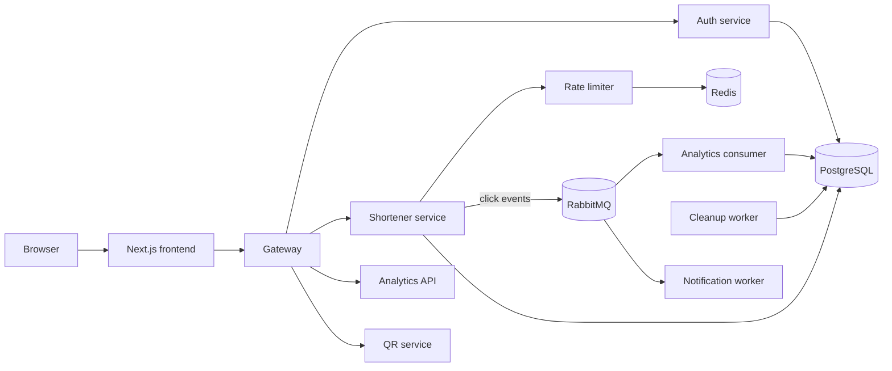
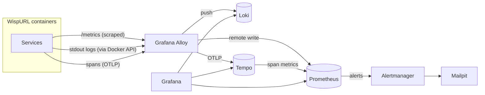

# Observability for WispURL, Part 0: What We're Building

> **In short:** we'll build a self-hosted observability stack for a Python microservices app using Prometheus for metrics, Loki for logs, Tempo for traces, Grafana Alloy as the single collector, OpenTelemetry inside the services, Grafana for dashboards and Alertmanager for alerts, all running locally with Docker Compose. This part explains what each tool does, why it was chosen over the alternatives, and the order we'll set them up in.

When something breaks in a system made of ten services, the hard part is rarely the fix. The hard part is finding out *where* it broke and *why*. Observability is the set of tools and habits that answer those questions quickly.

In this series we'll build a complete, local observability stack for a real microservices application, one piece at a time. Every part adds one tool, explains why it's there, and ends with a way to check that it works. By the end you will be able to:

- see how much traffic each service handles, how many requests fail, and how slow they are;
- search the logs of every container from one place;
- follow a single user request as it travels through several services and a message queue;
- jump from a log line to the request it belongs to, and back;
- get an email when something breaks, with a link to instructions for fixing it.

This first part is a map. There's nothing to install yet.

## The demo application: WispURL

WispURL is a URL shortener. You give it a long link, it gives you a short one, and it counts the clicks. It's built from small services that talk to each other, which makes it a good place to practise observability: a single click touches several of them.



*Figure: WispURL's services. The browser talks to the frontend, which calls the gateway. The gateway routes to the auth, shortener, analytics and QR services. The shortener checks limits with the rate limiter (backed by Redis) and publishes click events to RabbitMQ, where the analytics consumer and notification worker pick them up. PostgreSQL stores users, links and click statistics.*

The services are written in Python (FastAPI). You don't need to know Python to follow along: this series is about the DevOps side. We only touch application code where a tool needs the application's help, for example to expose metrics or to pass a trace ID along.

The whole application runs with Docker Compose. Before starting this series, get it running by following steps 1 to 6 of the repository's README (configure `.env`, start Vault, then `docker compose up --build -d`).

## The three signals

Observability tools collect three kinds of data. Each answers a different question.

| Signal | What it is | The question it answers | WispURL example |
| --- | --- | --- | --- |
| **Metrics** | Numbers measured over time | "Is something wrong, and how bad is it?" | The shortener is answering 40 requests per second and 3% of them fail. |
| **Logs** | Text lines written by a program | "What exactly happened?" | `link_resolved short_code=Iq4wPsS hits=12` |
| **Traces** | The path of one request through many services | "Where did the time go, and which service failed?" | A redirect took 900 ms; 850 ms of it was one SQL query in the shortener. |

Metrics tell you *that* something is wrong. Traces tell you *where*. Logs tell you *why*. The real power comes from linking them: an alert fires on a metric, a dashboard shows which service, a trace shows which call, and the trace links to the exact log lines.

## The tools

We'll use the open-source "LGTM" family from Grafana Labs plus Prometheus and OpenTelemetry. Each tool does one job.

| Tool | Job | Why this one |
| --- | --- | --- |
| **Prometheus** | Stores metrics and evaluates alert rules | The standard for metrics. Almost every tool exposes data in its format. |
| **Grafana Alloy** | The collector: finds containers, scrapes metrics, tails logs, receives traces, and forwards each to the right store | One agent for all three signals instead of three separate ones. |
| **Loki** | Stores logs | Indexes only a few labels, so it's cheap to run and fast to filter. |
| **Tempo** | Stores traces | Needs only local disk (or object storage), with no database to manage. |
| **OpenTelemetry** | The libraries inside each service that create traces | A vendor-neutral standard: the same code works with any tracing backend. |
| **Grafana** | Dashboards and searching | Reads from Prometheus, Loki and Tempo and links them together. |
| **Alertmanager** | Sends alert notifications | Groups, routes and silences alerts that Prometheus raises. |
| **Mailpit** | A fake mail server | Catches alert emails locally so you can read them in a browser. |

## Design decisions: why this stack

There are many ways to build observability. Here is why this series picks these tools, and what you give up by doing so. If your situation differs, the reasoning tells you when to choose differently.

### Self-hosted open source, not a SaaS product

Hosted products such as Datadog, New Relic or Honeycomb are excellent: you install an agent and get dashboards in minutes. We self-host instead because:

- **You learn the moving parts.** Running Prometheus, Loki and Tempo yourself teaches you what every hosted product does behind the scenes.
- **Cost scales with data, not with seats or hosts.** Hosted pricing per host, per GB of logs or per million spans gets expensive quickly in a microservices system.
- **The protocols carry over.** Everything here speaks open protocols: the Prometheus exposition format, Prometheus remote write, OTLP, and the Loki push API. When WispURL moves to AWS, Amazon Managed Service for Prometheus and Amazon Managed Grafana accept the same data. We change where Alloy sends it, not how the services produce it.

The trade-off is that you operate the stack yourself: upgrades, disk, retention. On a laptop that's a small price. In production, many teams use managed versions of these same tools.

### Prometheus, Loki and Tempo, not Elasticsearch (ELK)

The classic alternative is the ELK stack: Elasticsearch, Logstash and Kibana, or its fork OpenSearch. Elasticsearch builds a full-text index of every word in every log line. That makes arbitrary text search fast, but the index is often as large as the data itself and needs a lot of memory.

Loki takes the opposite approach. It indexes only a handful of **labels** (service, level, container) and stores the log text compressed. You first narrow down by label, then Loki scans the matching text. This is much cheaper to run and fits comfortably on a laptop. The cost is that a search across *all* logs for a random word is slower than in Elasticsearch. For operations work, where you almost always know which service you're looking at, that's a good trade.

Using one family (Prometheus, Loki, Tempo, all viewed in Grafana) also means the signals link to each other out of the box: a log line can link to its trace, and a trace to its logs.

### Tempo, not Jaeger

Jaeger is the other popular open-source tracing backend, and it would work: it accepts OpenTelemetry data too. Jaeger needs a storage backend such as Cassandra, Elasticsearch or its embedded Badger database. Tempo stores traces as plain files on local disk or in object storage (S3) and needs no database at all. It also turns traces into metrics (request rates and a service map) and integrates directly with Grafana. That's less to run for more features.

### One collector (Grafana Alloy), not one agent per signal

Without a unified collector you'd typically run Promtail for logs, a Prometheus server or agent for metrics, and an OpenTelemetry Collector for traces: three configs, three things to upgrade. Alloy does all three in one process with one config language. Promtail, Loki's old log agent, is deprecated in favour of Alloy.

The closest alternative is the **OpenTelemetry Collector**, which is vendor-neutral and also handles all three signals. Alloy actually embeds OpenTelemetry Collector components (you'll see them as `otelcol.*` in Part 9) and adds first-class Prometheus scraping and Loki log pipelines on top. For a Prometheus/Loki/Tempo backend, Alloy is the more direct fit. If your backends were a mix of vendors, the OpenTelemetry Collector would be the safer choice.

### OpenTelemetry for instrumentation

The code that creates traces lives inside the services, so changing it later is expensive. OpenTelemetry is the industry standard, supported by every major backend. Instrumenting with it once means the services never need to change when the backend does.

### Pull for metrics, push into storage

Prometheus was designed to **pull** (scrape) metrics: it asks each service for its numbers. Pulling has real benefits. Prometheus decides the pace, a dead service is noticed immediately because the scrape fails, and services don't need to know where monitoring lives.

We keep the pull model at the edge (Alloy scrapes the services) and then **push** from Alloy into Prometheus with remote write. That gives one collector for everything, and it matches the cloud: managed Prometheus services only accept remote write.

### What we deliberately leave out locally

A production setup would add high availability (two of everything), long-term metric storage (Mimir or Thanos), object storage for Loki and Tempo, authentication on every tool, and multi-tenancy. None of that teaches anything new on a single laptop, and all of it adds moving parts. We note each one where it matters, and the cloud series adds what production needs.

## How the data flows



*Figure: data flow. Services expose metrics, print logs and send spans; Grafana Alloy collects all three and forwards metrics to Prometheus (remote write), logs to Loki and traces to Tempo. Tempo also writes span metrics to Prometheus. Prometheus sends alerts to Alertmanager, which emails them to Mailpit. Grafana reads from Prometheus, Loki and Tempo.*

A few things to notice:

- **Alloy is the only thing that talks to the application.** Services expose metrics, print logs and send spans; Alloy collects all of it. If we later move to the cloud, only Alloy's destinations change.
- **Prometheus doesn't scrape the services itself.** Alloy scrapes them and *pushes* ("remote writes") the results into Prometheus. Prometheus still scrapes the observability tools directly, so if Alloy dies, Prometheus notices.
- **Tempo produces metrics too.** It turns traces into request-rate and service-map metrics and writes them to Prometheus.

## Two Compose projects, one network

The observability tools run in their own Compose project, defined in a separate file, `compose.observability.yaml`, next to the application's `docker-compose.yml`. That keeps them separate: you can restart or wipe monitoring without touching the app, and vice versa.

The two projects meet on one Docker network. The application's Compose project creates a network called `wispurl_wispurl-network`. Alloy joins it so it can reach the services; everything else stays on a private `observability` network.

## What the finished setup looks like

These are the files we'll create or change over the series:

```text
compose.observability.yaml          # the observability stack (grows every part)
observability/
├── prometheus/
│   ├── prometheus.yml              # what Prometheus scrapes, where alerts go
│   └── rules/wispurl-alerts.yml    # alert rules
├── alloy/config.alloy              # the collector pipeline
├── loki/loki.yaml                  # log storage and retention
├── tempo/tempo.yaml                # trace storage and retention
├── grafana/
│   ├── provisioning/               # data sources and dashboard loading, as code
│   └── dashboards/                 # dashboard JSON files
├── alertmanager/alertmanager.yml   # who gets notified, and how
└── secrets/                        # passwords (git-ignored)
shared/wispurl_metrics/             # metrics library used by every service
shared/wispurl_otel/                # tracing library used by every service
docs/runbooks/                      # what to do when each alert fires
```

And these are the addresses you'll use. Every port is bound to `127.0.0.1`, so nothing is reachable from other machines on your network.

| Tool | Address |
| --- | --- |
| Grafana | http://127.0.0.1:3001 |
| Prometheus | http://127.0.0.1:9090 |
| Alertmanager | http://127.0.0.1:9093 |
| Mailpit | http://127.0.0.1:8025 |
| Alloy UI | http://127.0.0.1:12345 |
| Loki API | http://127.0.0.1:3100 |
| Tempo API | http://127.0.0.1:3200 |

## Versions used in this series

Every image is pinned to an exact version, so what you build matches what's written here.

| Image | Tag |
| --- | --- |
| `prom/prometheus` | `v3.15.0` |
| `grafana/alloy` | `v1.20.1` |
| `grafana/loki` | `3.7.8` |
| `grafana/tempo` | `3.1.0` |
| `grafana/grafana` | `13.2.4` |
| `prom/alertmanager` | `v0.34.1` |
| `axllent/mailpit` | `v1.31.6` |
| OpenTelemetry Python | `1.45.1` / instrumentation `0.66b1` |

Tip: on Docker Hub, Prometheus, Alertmanager and Alloy put a `v` in front of the version; Loki, Tempo and Grafana don't. Loki and Tempo also publish many `main-…` and `weekly-…` builds, so use the tag filter box to find release tags.

## The plan

We'll build in this order. Each part only depends on the ones before it.

| Part | What you add | What you can do afterwards |
| --- | --- | --- |
| 1 | Prometheus | Store and query metrics |
| 2 | Metrics in the Python services | Count requests, errors and latency per route |
| 3 | Grafana Alloy (metrics) | Collect service metrics automatically |
| 4 | PostgreSQL, Redis and RabbitMQ metrics | Watch the dependencies |
| 5 | Host and container metrics | See CPU, memory and disk usage |
| 6 | Grafana | Explore everything in one UI |
| 7 | Loki | Store logs with a retention limit |
| 8 | Log collection with Alloy | Search clean, labelled, redacted logs |
| 9 | Tempo | Store traces |
| 10 | OpenTelemetry in the services | Record a trace per request |
| 11 | Trace propagation | Follow a request across services and RabbitMQ |
| 12 | Database and Redis tracing | See every query inside a trace |
| 13 | Linking logs and traces | Jump from a log line to its trace and back |
| 14 | Dashboards as code | RED and USE dashboards in Git |
| 15 | Alerting | Get an email when something breaks |
| 16 | Runbooks | Know what to do when it does |

## Before you start

You'll need:

- Docker Desktop or Docker Engine with Compose v2;
- the WispURL app running (README steps 1 to 6);
- a terminal and a text editor;
- basic comfort with YAML and the command line.

If you're starting from the finished repository rather than building as you read, all the files described in this series already exist. Read along to understand them, and use the "Check that it works" section at the end of each part to verify your setup.

In [Part 1](01-start-the-stack-with-prometheus.md) we create the observability Compose file and start Prometheus.

## Key takeaways

- Metrics show *that* something is wrong, traces show *where*, and logs show *why*. The value comes from linking all three.
- Prometheus, Loki and Tempo form one family that Grafana links together, and they're far lighter to run than an Elasticsearch-based stack.
- One collector (Grafana Alloy) handles metrics, logs and traces, so the application only ever talks to one thing.
- OpenTelemetry keeps the services vendor-neutral: the backend can change without touching application code.
- Everything speaks open protocols (Prometheus format, remote write, OTLP), so the same setup moves to managed cloud services later.
- The observability tools run in their own Docker Compose project and share one network with the application.

## FAQ

### What is observability in microservices?

Observability is the ability to understand what a system is doing from the data it produces: metrics (numbers over time), logs (event records) and traces (the path of one request through many services). In microservices it matters more than in a single application, because one user action can touch many services and a failure in any of them can surface somewhere else.

### What is the difference between metrics, logs and traces?

Metrics are numbers measured over time, such as requests per second or error rate; they are cheap to store and good for alerting. Logs are text records of individual events, good for explaining exactly what happened. Traces record the path and timing of a single request across services, good for finding which service or call was slow or failed.

### Why use Loki instead of Elasticsearch for logs?

Loki indexes only a few labels (such as service and level) and stores the log text compressed, while Elasticsearch builds a full-text index of every word. That makes Loki much cheaper in memory and disk, at the cost of slower searches for arbitrary words across all logs. For operations work, where you usually know which service to look at, Loki is the better trade.

### Why use Grafana Alloy instead of Promtail or the OpenTelemetry Collector?

Alloy collects metrics, logs and traces in one process with one configuration, replacing separate agents. Promtail, Loki's older log agent, is deprecated in favour of Alloy. The OpenTelemetry Collector is a good vendor-neutral alternative; Alloy embeds its components and adds native Prometheus scraping and Loki log pipelines, which fits a Prometheus, Loki and Tempo backend more directly.

### Can this local setup be used in production?

The tools and protocols are the same ones used in production, but this setup leaves out high availability, long-term storage, object storage and authentication on purpose. In production you would add those, or use managed services such as Amazon Managed Service for Prometheus and Amazon Managed Grafana, which accept the same data.

---

**Series navigation:** [Series index](README.md) · Next: [Part 1, Start the Stack with Prometheus](01-start-the-stack-with-prometheus.md)
