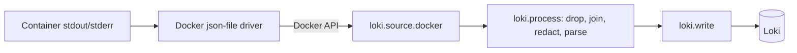

# Observability for WispURL, Part 8: Ship Container Logs with Alloy

> **In short:** make every line a service prints a single JSON object, including lines from third-party libraries, by routing Python's standard `logging` through structlog's `ProcessorFormatter`. Then have Grafana Alloy read container logs through the Docker API, label them with only low-cardinality values (`service`, `container`, `level`), move IDs such as `request_id` and `trace_id` into structured metadata, redact secrets, join multi-line tracebacks, drop health-check noise, and push the result to Loki. Order the pipeline stages: drop, then join, then redact, then parse.

Loki is running (Part 7). Now we fill it. In this part you'll:

1. make the services' log output easy for machines to read;
2. let Python services opt in to Python-specific log parsing;
3. build an Alloy pipeline that collects, cleans and labels logs;
4. connect Grafana to Loki and search with LogQL.

## How container logs reach Loki

Every container writes to its standard output and standard error. Docker's logging driver (`json-file`, which we capped at 3 × 10 MB in Part 1) stores those lines on the host. Alloy then:

1. **discovers** containers (the same `discovery.docker` component from Part 3);
2. **reads** each container's logs through the Docker API (`loki.source.docker`);
3. **processes** each line: drops, joins, redacts, parses and labels it (`loki.process`);
4. **pushes** the result to Loki (`loki.write`).



*Figure: a log line's path. The container prints it, Docker stores it, Alloy reads it through the Docker API, cleans and labels it in `loki.process`, and pushes it to Loki.*

## Design decisions

### Read through the Docker API, not from log files

Alloy could read Docker's log files from `/var/lib/docker/containers/*/*.log` directly. We read through the API instead because:

- on Docker Desktop those files live inside the Linux VM, and you'd need extra mounts to reach them;
- the API gives each line its container's metadata (name, labels, Compose service) for free;
- we already mount the socket for discovery (Part 3).

Alloy remembers how far it has read in each container in its `--storage.path` volume, so a restart picks up where it left off without duplicates or gaps.

### Structure logs at the source

Parsing free text with regular expressions is fragile: the first time someone rewords a log message, the pattern breaks. The reliable approach is to have programs write **structured logs** in the first place, one JSON object per line:

```json
{"service": "shortener-service", "level": "info", "timestamp": "2026-10-17T18:21:06Z", "request_id": "obs-check-11", "trace_id": "75a7d2da8ebb66d1152963b46136b4de", "message": "link_resolved"}
```

The collector then only has to *read* fields, not guess at them. The rule that makes this work is: **every line the service prints must be JSON**, not just the lines your own code writes.

That rule is easy to break by accident. A Python service has two logging systems:

- **structlog**, which the application code uses;
- the **standard library's `logging`**, which every third-party library uses: httpx, uvicorn, SQLAlchemy, aio-pika.

If only structlog is configured for JSON, the libraries still print plain text. In WispURL, httpx logs a line for every outgoing request:

```text
HTTP Request: GET http://shortener-service:8000/3JaFOUq "HTTP/1.1 307 Temporary Redirect"
```

That plain line has no level, no service and no trace ID, and (as you'll see below) it can break the multi-line stage. The fix is to send the standard library's records through structlog's processors too, so they come out as JSON with the same fields.

### Labels: few values only

From Part 7: every unique label combination is a separate stream, so labels must have small, fixed sets of values. We use:

| Label | Example | Source |
| --- | --- | --- |
| `service` | `shortener-service` | The Compose service name; matches metrics and traces |
| `container` | `wispurl-shortener-service-1` | Container name |
| `level` | `info`, `error` | Parsed from the line |
| `environment`, `application` | `docker`, `wispurl` | Constant |
| `log_format` | `python` | Opt-in label, explained below |

`request_id`, `trace_id` and `span_id` go into **structured metadata** instead: searchable, but not indexed.

### Opt in to format-specific parsing

The JSON and traceback rules only make sense for containers whose log format we know. Postgres, Redis and RabbitMQ each write their own format; applying Python rules to them would mangle their lines. So Python services carry a Docker label, `logging.wispurl/format: python`, and the Python-specific stages only run for streams with that label. It's the same opt-in idea as the `prometheus.io/*` labels in Part 3.

### Order the stages carefully

A `loki.process` block runs its stages top to bottom, and the order changes the result:

1. **Drop noise first**, line by line. If a health-check line were dropped *after* joining, it could already have been glued onto a real error, and dropping it would delete the error too.
2. **Join multi-line entries.** A crash in Gunicorn prints a plain-text traceback over many lines. Joining them makes one error one entry.
3. **Redact secrets** on the complete entry, before anything is extracted from it.
4. **Parse fields** last: extract `level` as a label and the IDs as structured metadata.

### Redact in the pipeline too

WispURL's `logging_config.py` already replaces values of keys like `password` and `token` with `[redacted]`. The pipeline repeats the job with patterns, because the app can only scrub what it knows about: a library might log a full URL with a password in it, or a developer might log a request header. This is **defence in depth**. Neither layer is perfect, and the real rule remains: don't log secrets.

## Step 1: JSON logs from every logger

The relevant part of each service's `shared/logging_config.py`:

```python
    shared_processors: list[Any] = [
        structlog.contextvars.merge_contextvars,
        # trace_id/span_id of the active span, so a log line links to its trace.
        add_trace_context,
        _scrub_secrets,
        structlog.processors.add_log_level,
        structlog.processors.TimeStamper(fmt="iso", utc=True),
    ]
    render_processors: list[Any] = [
        # Turn exc_info into an "exception" string, so a traceback stays inside
        # its single JSON line instead of spilling over many lines.
        structlog.processors.format_exc_info,
        structlog.processors.EventRenamer("message"),
        structlog.processors.JSONRenderer(),
    ]

    # Standard-library loggers: render through the same processors as structlog.
    stdlib_formatter = structlog.stdlib.ProcessorFormatter(
        foreign_pre_chain=[*shared_processors, structlog.stdlib.add_logger_name],
        processors=[
            structlog.stdlib.ProcessorFormatter.remove_processors_meta,
            *render_processors,
        ],
    )
    handler = logging.StreamHandler(sys.stdout)
    handler.setFormatter(stdlib_formatter)
    root_logger = logging.getLogger()
    root_logger.handlers = [handler]
    root_logger.setLevel(log_level.upper())

    structlog.configure(
        processors=[
            *shared_processors,
            *render_processors,
        ],
        # ...
    )
```

> `auth-service/shared/logging_config.py` lines 60–100. The same file is copied into each service's `shared/` folder.

How it fits together:

- **`shared_processors`** run for every log record, from structlog or the standard library. They add the request context (`request_id`), the trace context (`trace_id`, `span_id`; explained in Part 13), scrub secrets, and add `level` and an ISO `timestamp`.
- **`render_processors`** turn the record into a line. `format_exc_info` converts an exception into a single `exception` string, so a traceback becomes part of one JSON value instead of twenty separate lines. `EventRenamer("message")` names the main text `message`, and `JSONRenderer` writes the object.
- **`ProcessorFormatter`** is structlog's bridge to the standard library. It's attached to the **root** logger's handler, so every library's records go through `foreign_pre_chain` (the shared processors plus `add_logger_name`, which records *which* library logged it) and then the same renderer.

After this change, the httpx line becomes:

```json
{"service": "gateway", "trace_id": "75a7d2da8ebb66d1152963b46136b4de", "span_id": "f72797c374d3f08f", "level": "info", "timestamp": "2026-10-17T18:21:06.128724Z", "logger": "httpx", "message": "HTTP Request: GET http://shortener-service:8000/abc \"HTTP/1.1 307 Temporary Redirect\""}
```

Gunicorn's own messages (worker start, shutdown, boot failures) still use Gunicorn's format, `[2026-10-17 13:30:37 +0000] [1] [INFO] ...`. The pipeline handles those separately.

## Step 2: Label the Python services

In `docker-compose.yml`, define the opt-in label as an anchor:

```yaml
# Alloy parses these containers' logs as Python JSON logs (plus Gunicorn lines).
x-python-log-labels: &python-log-labels
  logging.wispurl/format: python
```

> `docker-compose.yml` lines 12–14.

The six HTTP services already merge it with the metrics labels (`<<: [*prometheus-labels, *python-log-labels]`, Part 3). The three workers get it on its own:

```yaml
  analytics-consumer-service:
    # ...
    labels:
      <<: *python-log-labels
```

> For example `docker-compose.yml` lines 264–265. The same goes for `cleanup-service` and `notification-service`.

Rebuild (the logging change is in the images) and recreate:

```sh
docker compose up --build -d
```

## Step 3: Build the log pipeline in Alloy

Append to `observability/alloy/config.alloy`.

### 3a. Choose containers and labels

```alloy
discovery.relabel "logs" {
  targets = discovery.docker.containers.targets

  rule {
    source_labels = ["__meta_docker_network_name"]
    regex         = sys.env("WISPURL_NETWORK")
    action        = "keep"
  }

  rule {
    source_labels = ["__meta_docker_container_name"]
    regex         = "^/(.+)$"
    target_label  = "container"
    replacement   = "$1"
  }

  rule {
    source_labels = ["__meta_docker_container_label_com_docker_compose_service"]
    regex         = "^(.+)$"
    target_label  = "service"
    replacement   = "$1"
  }

  // Python services opt in to JSON parsing with the label logging.wispurl/format=python.
  rule {
    source_labels = ["__meta_docker_container_label_logging_wispurl_format"]
    regex         = "^(.+)$"
    target_label  = "log_format"
    replacement   = "$1"
  }

  rule {
    target_label = "environment"
    replacement  = "docker"
  }

  rule {
    target_label = "application"
    replacement  = "wispurl"
  }
}
```

> `config.alloy` lines 133–173.

This reuses the discovery from Part 3, with a separate relabel for logs. **Every** container on the WispURL network is kept (Postgres and RabbitMQ logs are useful too), not just the ones that opted in to metrics. The `log_format` label is only set on containers that carry the opt-in label; on the rest the regex doesn't match and no label is written.

### 3b. Read the logs

```alloy
loki.source.docker "wispurl" {
  host = "unix:///var/run/docker.sock"

  targets = discovery.relabel.logs.output

  relabel_rules = discovery.relabel.logs.rules

  forward_to = [loki.process.wispurl.receiver]
}
```

> `config.alloy` lines 175–183.

`targets` limits which containers are tailed. `relabel_rules` applies the same rules to the labels attached to each log entry, which is how `service`, `container` and the rest end up on the lines. `forward_to` sends every line into the processing stage.

### 3c. Clean, join, redact and parse

```alloy
loki.process "wispurl" {
  forward_to = [loki.write.loki.receiver]

  // 4a. Drop probe noise first, line by line.
  stage.drop {
    expression          = "(GET|HEAD) /(health|ready|live|metrics)\\b"
    drop_counter_reason = "probe_noise"
  }

  // 4b. Python services: glue traceback lines onto the line that started them.
  stage.match {
    selector = "{log_format=\"python\"}"

    stage.multiline {
      firstline     = "^(\\{|\\[\\d{4}-\\d{2}-\\d{2} )"
      max_wait_time = "3s"
      max_lines     = 500
    }
  }

  // 4c. Redact secrets in every container's logs.
  stage.replace {
    expression = "(?i)bearer\\s+([A-Za-z0-9._~+/-]+=*)"
    replace    = "[REDACTED]"
  }
  stage.replace {
    expression = "(eyJ[A-Za-z0-9_-]+\\.eyJ[A-Za-z0-9_-]+\\.[A-Za-z0-9_-]+)"
    replace    = "[REDACTED_JWT]"
  }
  stage.replace {
    expression = "[a-zA-Z][a-zA-Z0-9+.-]*://[^:/@\\s\"]+:([^@/\\s\"]+)@"
    replace    = "[REDACTED]"
  }
  stage.replace {
    expression = "(?i)\"?(?:password|passwd|secret|api[_-]?key|token)\"?\\s*[:=]\\s*\"?([^\"\\s,}]+)"
    replace    = "[REDACTED]"
  }
  stage.replace {
    expression = "(hv[sbr]\\.[A-Za-z0-9_-]{20,})"
    replace    = "[REDACTED_VAULT_TOKEN]"
  }

  // 4d. Python services: pull fields out of the line.
  stage.match {
    selector = "{log_format=\"python\"}"

    stage.json {
      expressions = {
        level      = "level",
        request_id = "request_id",
        trace_id   = "trace_id",
        span_id    = "span_id",
      }
    }

    stage.regex {
      expression = "^\\[[^\\]]+\\] \\[\\d+\\] \\[(?P<gunicorn_level>[A-Z]+)\\]"
    }

    stage.template {
      source   = "level"
      template = "{{ if .Value }}{{ ToLower .Value }}{{ else if .gunicorn_level }}{{ ToLower .gunicorn_level }}{{ end }}"
    }

    stage.labels {
      values = {
        level = "",
      }
    }

    stage.structured_metadata {
      values = {
        request_id = "",
        trace_id   = "",
        span_id    = "",
      }
    }
  }
}
```

> `config.alloy` lines 185–279 (comments shortened here).

A note on escaping first: Alloy strings use backslash escapes, so a regex `\s` is written `"\\s"` and a quote inside a string is `\"`. Check patterns in the Alloy UI's live debugging view, or with test lines (below), not just by reading them.

Stage by stage:

**`stage.drop`** removes any line containing a probe request, such as `GET /health`, so kubelet-style health checks and metric scrapes don't bury real events. `\b` (a word boundary) stops it from matching `/healthy-links`. `drop_counter_reason` names the reason in Alloy's `loki_process_dropped_lines_total` metric, so you can see how much is being dropped.

**`stage.match`** runs its nested stages only for streams matching a LogQL selector, here `{log_format="python"}`.

**`stage.multiline`** decides which lines **start** a new entry using the `firstline` regex. Every other line is appended to the entry before it. For Python services, an entry starts with `{` (a JSON line) or `[2026-10-17 ` (a Gunicorn line); traceback lines start with neither, so they're glued on. This is also why Step 1 matters: before stdlib logs were JSON, the plain `HTTP Request:` lines didn't match `firstline` either, and got glued onto whatever came before them. `max_wait_time: 3s` sends an entry on if no new line arrives, so the last entry doesn't wait forever. `max_lines: 500` caps the size of a joined entry.

**`stage.replace`** finds the regex in the line and replaces each **capture group** (the parts in parentheses) with `replace`. That's why the patterns put parentheses around just the secret: in `bearer\s+(token)`, only the token is replaced, so `Bearer [REDACTED]` keeps its context. The five patterns cover:

| Pattern | Catches |
| --- | --- |
| `bearer\s+(...)` | `Authorization: Bearer <token>` headers |
| `(eyJ...\.eyJ...\....)` | Any JWT, wherever it appears |
| `scheme://user:(password)@` | Passwords inside connection URLs for PostgreSQL, RabbitMQ, Redis and others |
| `password=...`, `"token": "..."` | Key-value secrets in text or JSON |
| `(hv[sbr]\....)` | HashiCorp Vault tokens |

**`stage.json`** reads fields from a JSON line into the pipeline's temporary **extracted map**. On a Gunicorn line, which isn't JSON, it finds nothing and the pipeline carries on.

**`stage.regex`** extracts the level from Gunicorn's format (`[INFO]`, `[ERROR]`) into `gunicorn_level`.

**`stage.template`** uses Go templating to produce one lowercase `level` from whichever source had a value, so JSON lines and Gunicorn lines share the same label values.

**`stage.labels`** promotes `level` to a real Loki label: a handful of values, cheap to index, and the most common filter.

**`stage.structured_metadata`** attaches the IDs to each line without making them labels.

### 3d. Send to Loki

```alloy
loki.write "loki" {
  endpoint {
    url = "http://loki:3100/loki/api/v1/push"
  }
}
```

> `config.alloy` lines 281–285.

This uses the push API you tested by hand in Part 7. `loki.write` batches lines and retries on failure, buffering in memory while Loki is unavailable.

Validate and restart Alloy:

```sh
docker run --rm -e WISPURL_NETWORK=wispurl_wispurl-network \
  -v "$PWD/observability/alloy:/c:ro" grafana/alloy:v1.20.1 validate /c/config.alloy && echo valid
docker compose -f compose.observability.yaml restart alloy
```

## Step 4: Connect Grafana to Loki

Add Loki to `observability/grafana/provisioning/datasources/datasources.yaml`, after Prometheus:

```yaml
  - name: Loki
    uid: loki
    type: loki
    access: proxy
    url: http://loki:3100
    jsonData:
      maxLines: 1000
```

> `datasources.yaml` lines 14–20. Part 13 adds a `derivedFields` block here that turns trace IDs into links.

`maxLines: 1000` is how many lines Grafana fetches per query by default. Higher values make Explore slower and use more browser memory.

Restart Grafana to load the change:

```sh
docker compose -f compose.observability.yaml restart grafana
```

## Check that it works

Open Grafana → **Explore**, select **Loki**, switch to **Code** mode, and try these **LogQL** queries. LogQL always starts with a stream selector in braces, then optional filters.

**All logs from one service:**

```logql
{service="shortener-service"}
```

**Only errors, from every service:**

```logql
{application="wispurl", level="error"}
```

**Text search within a service.** `|=` keeps lines containing the text:

```logql
{service="gateway"} |= "HTTP Request"
```

Expand a line: it's JSON, it has `level` and `service` labels, and the trace and request IDs appear as structured metadata.

**Every line for one request**, across all services, using structured metadata:

```logql
{application="wispurl"} | request_id="obs-check-11"
```

(Send a request with your own ID first: `curl -H 'X-Request-ID: my-test-1' http://localhost:8080/<short-code>`, then filter on `my-test-1`.)

**Parse JSON fields at query time** and filter on any of them:

```logql
{service="shortener-service"} | json | logger="httpx"
```

**Count log lines per service and level**, a metric made from logs:

```logql
sum by (service, level) (count_over_time({application="wispurl"}[5m]))
```

### Test the cleaning stages

Run a short-lived container on the WispURL network with the Python opt-in label, printing a secret, a Gunicorn crash with a traceback, and a probe line. It waits 70 seconds first, so Alloy's one-minute discovery has time to see it:

```sh
docker run -d --rm --name logpipe-test --network wispurl_wispurl-network \
  --label logging.wispurl/format=python --label com.docker.compose.service=logpipe-test \
  python:3.13-slim python -c '
import json, time
time.sleep(70)
print(json.dumps({"level": "error", "message": "login_failed", "request_id": "req-2", "password": "hunter2"}), flush=True)
print("[2026-10-17 18:00:00 +0000] [7] [ERROR] Exception in worker process", flush=True)
print("Traceback (most recent call last):", flush=True)
print("  File \"/app/app/main.py\", line 3, in <module>", flush=True)
print("SyntaxError: logpipe traceback test", flush=True)
print("127.0.0.1 - \"GET /health HTTP/1.1\" 200", flush=True)
time.sleep(30)'
```

After about 90 seconds, query `{service="logpipe-test"}`. You should see exactly two entries:

1. the JSON line, with `level="error"`, `request_id` in its metadata, and `"password": "[REDACTED]"`;
2. the Gunicorn error **with its three traceback lines joined into the same entry**, labelled `level="error"`.

The `/health` line is gone, and it didn't take the traceback with it.

## When something goes wrong

| Symptom | Likely cause | Fix |
| --- | --- | --- |
| Logs from a short-lived container never arrive | Discovery refreshes once a minute | Expected for containers that live under a minute. Shorten `refresh_interval` on `discovery.docker` if it matters. |
| Unrelated lines glued together | Lines that don't match `firstline` | Make the service print JSON for every logger (Step 1), or adjust `firstline`. |
| No `level` label | The container lacks the opt-in label, or the line isn't JSON | Check its labels with `docker inspect`; check the line format. |
| Duplicate lines after restarting Alloy | Alloy's storage was lost | Keep `--storage.path` on a named volume. |
| `429` errors in Alloy logs | Loki rate limit | Find the container flooding logs, or raise Loki's `ingestion_rate_mb`. |
| A secret still visible | No pattern matches it | Add a `stage.replace`, test it with a container as above, and fix the code that logs it. |

## What you have now

- Every line from every Python service is a single JSON object, including library logs and tracebacks.
- Alloy collects logs from every container on the WispURL network.
- Lines carry a small set of labels, with request and trace IDs as structured metadata.
- Secrets are redacted before leaving the host, multi-line crashes are one entry, and probe noise is dropped.
- Grafana can search it all with LogQL.

In [Part 9](09-store-traces-in-tempo.md) we deploy Tempo, the last storage backend, and route traces to it through Alloy.

## Key takeaways

- Make services emit one JSON object per line, from **every** logger. Route the standard library through the same formatter as your structured logger.
- Format exceptions into a single field so tracebacks don't spill across lines.
- Only low-cardinality values become Loki labels; IDs go in structured metadata.
- Opt containers in to format-specific parsing with a label instead of guessing their format.
- Pipeline order matters: drop noise, join multi-line entries, redact, then parse.
- Redact in the collector as a safety net, but never rely on it instead of not logging secrets.

## FAQ

### How do I send Docker container logs to Loki?

Use a collector such as Grafana Alloy: `discovery.docker` to find containers, `loki.source.docker` to read their logs through the Docker API, optionally `loki.process` to parse and label them, and `loki.write` to push them to Loki's `/loki/api/v1/push` endpoint.

### How do I make Python library logs JSON with structlog?

Attach a `structlog.stdlib.ProcessorFormatter` to the root logger's handler, with `foreign_pre_chain` set to your shared processors and `processors` ending in `JSONRenderer`. Standard-library records from httpx, uvicorn, SQLAlchemy and others then render as JSON with the same fields as your structlog logs.

### How do I handle multi-line stack traces in Loki?

Best: log exceptions as a single JSON field (structlog's `format_exc_info`), so there's nothing to join. For plain-text tracebacks you can't control, use Alloy's `stage.multiline` with a `firstline` regex that matches how a new entry begins; every non-matching line is appended to the previous entry.

### How do I redact secrets from logs in Grafana Alloy?

Use `stage.replace` in `loki.process` with a regex whose capture group wraps the secret, for example `(?i)bearer\s+([A-Za-z0-9._~+/-]+=*)`. Only the captured part is replaced, so the surrounding context stays readable. Treat it as a safety net alongside fixing the code that logs secrets.

### Should trace IDs be Loki labels?

No. Each unique label value creates a new stream, so per-request IDs would create millions of streams. Store them as structured metadata, which is attached to each line and searchable with `| trace_id="..."` without being indexed.

---

**Series navigation:** Previous: [Part 7, Store Logs in Loki](07-store-logs-in-loki.md) · [Series index](README.md) · Next: [Part 9, Store Traces in Tempo](09-store-traces-in-tempo.md)
