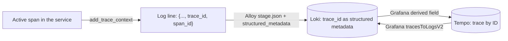

# Observability for WispURL, Part 13: Link Logs and Traces

> **In short:** stamp every log line with the active `trace_id` and `span_id` using a small structlog processor; have Alloy store them as Loki structured metadata (not labels); then configure Grafana's Loki data source with a **derived field** that turns `trace_id` into a "View trace" link to Tempo, and the Tempo data source with **`tracesToLogsV2`** so any span links to that service's logs for the same trace. It only works because metrics, logs and traces all use the same service names.

You now have metrics, logs and traces, but they're three separate places to look. During an incident the real cost is the time spent copying an ID from one tool, pasting it into another, and guessing the time range. In this part you'll link logs and traces in both directions, so a single click takes you from a log line to the request it belongs to, or from a slow span to the logs written during it.

## How the link works



*Figure: the service writes the active trace ID into each log line; Alloy stores it as structured metadata in Loki; Grafana turns it into a link to the trace in Tempo, and Tempo links back to the logs.*

Three pieces, each built in an earlier part:

1. **The service writes the trace ID into each log line**, while a span is active.
2. **Alloy extracts it into structured metadata** (Part 8), so it's searchable but not an index label.
3. **Grafana knows how to follow it** in both directions, configured in the data sources.

## Design decisions

### Trace IDs and request IDs: why both?

WispURL logs carry two identifiers:

| ID | Where it comes from | Best for |
| --- | --- | --- |
| `request_id` | The `X-Request-ID` header, set by the caller or generated by the gateway | Humans: a support ticket can quote it, and a client can send its own |
| `trace_id` | OpenTelemetry, propagated in `traceparent` | Tools: it links directly to the trace in Tempo |

They overlap, but serve different audiences. A user-facing error page can show the request ID; Grafana uses the trace ID.

### Structured metadata, not labels

A trace ID is unique per request. As a Loki label it would create a new stream for every request (Part 7). As structured metadata it's stored with each line, filterable with `| trace_id="…"`, and costs nothing in the index.

### Consistent naming makes the reverse link possible

To go from a span to its logs, Grafana has to build a Loki query from the span. It knows the span's `service.name` (`shortener-service`) and must turn that into a Loki label selector. Because Part 2 and Part 8 used the Compose service name everywhere, the mapping is one line: Tempo's `service.name` equals Loki's `service`. With mismatched names (`shortener` in one place and `shortener-service` in another), you'd need a mapping per service, or the link would quietly find nothing.

### What about metrics to traces?

The third link, from a spike on a latency graph to an example trace, uses **exemplars**: a few trace IDs attached to histogram samples. It needs the services to expose metrics in OpenMetrics format with exemplars, and Prometheus to run with `--enable-feature=exemplar-storage`. We've left it out for now to keep the metrics setup simple, and because span metrics and the service graph (Part 9) already link metrics and traces at the service level. It's a natural next step once everything else is familiar.

## Step 1: Write the trace ID into every log line

A structlog processor reads the current span and adds its IDs to the event:

```python
from opentelemetry import trace


def add_trace_context(
    _logger: Any,
    _method_name: str,
    event_dict: dict[str, Any],
) -> dict[str, Any]:
    span_context = trace.get_current_span().get_span_context()
    if span_context.is_valid:
        # The same hex format Tempo and Grafana display, so IDs can be searched as-is.
        event_dict["trace_id"] = format(span_context.trace_id, "032x")
        event_dict["span_id"] = format(span_context.span_id, "016x")
    return event_dict
```

> `shared/wispurl_otel/src/wispurl_otel/log_correlation.py` lines 7–20.

- **`trace.get_current_span()`** returns whatever span is active at the moment the log call is made: the request span, a database span, the CONSUMER span for a message. Logs made outside any span (start-up, for example) get no IDs; `is_valid` checks for that.
- **Formatting matters.** OpenTelemetry stores IDs as integers. Tempo and Grafana display them as zero-padded lowercase hex, 32 characters for a trace ID and 16 for a span ID. `format(..., "032x")` produces exactly that, so the ID in a log line can be pasted straight into Tempo.

It sits in the shared processor chain from Part 8, after the request context:

```python
    shared_processors: list[Any] = [
        structlog.contextvars.merge_contextvars,
        # trace_id/span_id of the active span, so a log line links to its trace.
        add_trace_context,
        # ...
```

> `auth-service/shared/logging_config.py` lines 60–63.

Because the chain is shared, both structlog logs and standard-library logs (httpx, uvicorn and others) get trace IDs. That's why the httpx `HTTP Request:` lines in Part 8 carried a `trace_id`.

## Step 2: Alloy keeps the IDs as structured metadata

This was set up in Part 8. `stage.json` extracts `trace_id` and `span_id` from Python services' JSON lines, and `stage.structured_metadata` attaches them:

```alloy
    stage.structured_metadata {
      values = {
        request_id = "",
        trace_id   = "",
        span_id    = "",
      }
    }
```

> `observability/alloy/config.alloy` lines 271–277.

Nothing to add here; Step 1 just made sure the fields exist on every line.

## Step 3: From a log line to its trace

Extend the Loki data source in `observability/grafana/provisioning/datasources/datasources.yaml` with a **derived field**:

```yaml
  - name: Loki
    uid: loki
    type: loki
    access: proxy
    url: http://loki:3100
    jsonData:
      maxLines: 1000
      # Each log line carries trace_id as structured metadata (added by Alloy).
      # This turns it into a "View trace" link that opens the trace in Tempo.
      derivedFields:
        - name: TraceID
          matcherType: label
          matcherRegex: trace_id
          datasourceUid: tempo
          url: "$${__value.raw}"
          urlDisplayLabel: View trace
```

> `datasources.yaml` lines 14–29.

A derived field finds a value in each log line and turns it into a field, optionally a link:

- **`matcherType: label`** takes the value from a label or structured metadata field, named by `matcherRegex` (`trace_id`). The alternative, `matcherType: regex`, extracts the value from the line's text with a regular expression. Since Alloy already extracted the ID cleanly, reading it as metadata is more reliable than re-parsing the line.
- **`datasourceUid: tempo`** makes it an *internal* link: clicking it opens the Tempo data source in Grafana rather than an external URL. This is why fixed data-source UIDs (Part 6) matter.
- **`url: "$${__value.raw}"`** is the query sent to Tempo: the field's raw value, the trace ID. The doubled `$$` is escaping: Grafana's provisioning expands `$VARIABLE` from the environment, so a literal `$` must be written `$$`. Grafana stores it as `${__value.raw}`.
- **`urlDisplayLabel`** is the button text.

## Step 4: From a span to its logs

Extend the Tempo data source with `tracesToLogsV2`, between `jsonData:` and `serviceMap`:

```yaml
  - name: Tempo
    uid: tempo
    type: tempo
    access: proxy
    url: http://tempo:3200
    jsonData:
      # From any span, jump to the logs that service wrote during that trace.
      tracesToLogsV2:
        datasourceUid: loki
        spanStartTimeShift: "-5m"
        spanEndTimeShift: "5m"
        filterByTraceID: true
        tags:
          - key: service.name
            value: service
      # Service map built from Tempo's metrics-generator series in Prometheus.
      serviceMap:
        datasourceUid: prometheus
      nodeGraph:
        enabled: true
```

> `datasources.yaml` lines 31–50.

When you click "Logs for this span", Grafana builds a Loki query from these settings:

- **`tags`**: map span or resource attributes to Loki labels. `service.name` (on the span's resource) becomes `service="..."` in the selector. This is the one line that consistent naming made possible.
- **`filterByTraceID: true`** adds a filter for the trace ID, so you see only lines from this trace, not every line the service wrote at that time.
- **`spanStartTimeShift` / `spanEndTimeShift`** widen the time range around the span by five minutes either side. Log timestamps and span timestamps come from different clocks and can differ slightly, and async work (like the analytics consumer) may log after the span ends. Without some slack, the right lines could fall just outside the range.

The resulting query looks like:

```logql
{service="shortener-service"} |= "cf3af7bd0168bef62334f7ab4aeddd2c"
```

Restart Grafana to load the changes:

```sh
docker compose -f compose.observability.yaml restart grafana
```

## Check that it works

Generate a request with a known request ID, so it's easy to find:

```sh
curl -s -o /dev/null -H 'X-Request-ID: link-demo-1' http://localhost:8080/<short-code>
```

**Log to trace.** In Grafana → Explore → **Loki**:

```logql
{application="wispurl"} | request_id="link-demo-1"
```

You'll see the gateway's httpx `HTTP Request:` line for that request. Other services appear only if they log something while handling it; a normal redirect is quiet, while an error or a retry would show up here from every service involved. Expand the line: among the fields is **TraceID**, with a **View trace** button. Click it. The screen splits, and on the right the full trace opens in Tempo: gateway, shortener, RabbitMQ and analytics consumer, from one click.

**Trace to logs.** In the trace view, click any span from the shortener, then the **Logs for this span** icon. Loki opens with `{service="shortener-service"}` filtered to this trace ID, showing exactly the lines that request produced in that service.

**Search logs by trace ID directly.** Any trace ID from Tempo can be pasted into a Loki query:

```logql
{application="wispurl"} | trace_id="cf3af7bd0168bef62334f7ab4aeddd2c"
```

This returns every log line, from every service, written while that trace was active.

You can also check the provisioning from the API:

```sh
GP=$(cat observability/secrets/grafana_admin_password.txt)
curl -s -u "admin:$GP" http://127.0.0.1:3001/api/datasources/uid/loki | python3 -m json.tool | grep -A8 derivedFields
```

The `url` shows as `${__value.raw}`: the `$$` escaping worked.

## When something goes wrong

| Symptom | Likely cause | Fix |
| --- | --- | --- |
| No `trace_id` on log lines | The log was written outside a span, or the processor isn't in the chain | Check `add_trace_context` is in `shared_processors`; start-up logs legitimately have none. |
| Library log lines have no `trace_id` | Standard-library logs aren't routed through structlog | Use `ProcessorFormatter` with the shared processors (Part 8). |
| No "View trace" button | Derived field not configured, or the ID isn't in structured metadata | Check Alloy's `stage.structured_metadata`, and `matcherType: label` with `matcherRegex: trace_id`. |
| "View trace" opens an empty query | `url` lost its `$` | Write `$${__value.raw}` in the provisioning file. |
| "Logs for this span" finds nothing | Service names differ between traces and logs, or the time window is too tight | Make `service.name` and Loki's `service` label match; widen the time shifts. |
| Link opens in a new tab or the wrong data source | `datasourceUid` doesn't match | Use the fixed UIDs from Part 6. |

## What you have now

- Every log line written during a request carries its trace and span IDs.
- One click from a log line to its full trace, and from any span to its logs.
- Searches by trace ID or request ID across every service.

Investigating is now fast. Next we make the important signals visible at a glance: in [Part 14](14-dashboards-as-code.md) we build RED and USE dashboards and keep them in Git.

## Key takeaways

- Put the active trace and span IDs on every log line, formatted as Tempo displays them (32 and 16 hex characters).
- Keep IDs in Loki structured metadata, never in labels.
- A Loki derived field with `matcherType: label` turns `trace_id` into a link to Tempo; escape `$` as `$$` in provisioning files.
- Tempo's `tracesToLogsV2` builds the reverse query; it depends on matching service names and a little time slack.
- Request IDs are for people, trace IDs are for tools. Keep both.
- Exemplars (metrics to traces) are the next step, and need OpenMetrics output and Prometheus exemplar storage.

## FAQ

### How do I correlate logs and traces in Grafana?

Write the trace ID into each log line, store it in Loki (as structured metadata or in the line), add a derived field on the Loki data source that links `trace_id` to the Tempo data source, and configure `tracesToLogsV2` on the Tempo data source so spans link back to Loki.

### How do I add trace_id to Python logs?

Read the current span with `opentelemetry.trace.get_current_span().get_span_context()` and, if it's valid, add `format(ctx.trace_id, "032x")` and `format(ctx.span_id, "016x")` to the log record. With structlog, do this in a processor; route standard-library logging through the same processors so library logs get the IDs too.

### What is a derived field in Grafana Loki?

A data source setting that extracts a value from each log line, from the text with a regex or from a label or structured metadata field, and shows it as a field, optionally linking to another data source or URL. It's the usual way to turn trace IDs in logs into links to Tempo.

### Why does "Logs for this span" in Grafana return no logs?

Usually because the Loki label Grafana builds from the span doesn't exist: for example the span's `service.name` is `shortener-service` but Loki's label is `service="shortener"`. Map the attribute to the right label in `tracesToLogsV2.tags`, and widen `spanStartTimeShift` and `spanEndTimeShift` if logs are written slightly outside the span's time range.

### What are exemplars in Prometheus?

Sample trace IDs attached to individual metric data points, such as one slow request's trace ID on a latency histogram bucket. Grafana shows them as dots on graphs that link to the trace. They require metrics in OpenMetrics format with exemplars and Prometheus started with `--enable-feature=exemplar-storage`.

---

**Series navigation:** Previous: [Part 12, Trace Database and Redis Calls](12-trace-database-and-redis-calls.md) · [Series index](README.md) · Next: [Part 14, Dashboards as Code](14-dashboards-as-code.md)
