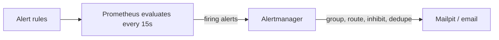

# Observability for WispURL, Part 15: Alerting with Prometheus and Alertmanager

> **In short:** Prometheus evaluates alert rules and sends firing alerts to Alertmanager, which groups, routes, inhibits and delivers them. Alert on **symptoms** users feel (error ratio, latency) and on things that will soon break everything (database down, disk full), give every alert a `for` duration, a `severity`, a `service` label and a runbook link, and remember that **missing data never fires `up == 0`**: catch it with `absent()` and an "existed recently but not now" rule. Locally, Mailpit plays the mail server, so you can watch alerts and resolutions arrive in a browser.

Dashboards help only when someone is looking. Alerts make the system come to you. In this part you'll:

1. decide what deserves an alert;
2. write the rules Prometheus evaluates;
3. run Alertmanager to route and deliver them;
4. catch the case most alert setups miss: data that just stops arriving;
5. watch a real alert fire, notify, and resolve.

## How alerting works



*Figure: Prometheus decides **whether** something is wrong; Alertmanager decides **who** hears about it, **how**, and **how often**.*

This split is deliberate. Rules live with the data and only answer "is this condition true?" Alertmanager handles everything human: batching ten related alerts into one message, sending critical ones to on-call and the rest to a team inbox, muting noise during a known outage, and not repeating itself every 15 seconds.

An alert moves through three states:

| State | Meaning |
| --- | --- |
| **inactive** | The condition is false |
| **pending** | The condition is true, but hasn't been true for the rule's `for` duration yet |
| **firing** | True for at least `for`; Prometheus sends it to Alertmanager |

## Design decisions

### Prometheus rules and Alertmanager, not Grafana alerting

Grafana has its own alerting engine, and it works well, especially for alerts across several data sources. We use Prometheus rules with Alertmanager because:

- **The rules live in Git** next to the Prometheus config, validated by `promtool` before they're applied.
- **They keep working if Grafana is down.** Alerting doesn't depend on the dashboard tool.
- **They carry over to the cloud.** Amazon Managed Service for Prometheus accepts the same rule files and runs a managed Alertmanager.

### Alert on symptoms, not on every possible cause

Something that pages a person should mean "users are affected now, or will be very soon". Two kinds of alert meet that bar:

- **Symptoms**: users are getting errors or slow responses. `HighErrorRate` and `HighLatencyP95` fire on the same RED signals the dashboard shows, whatever the cause.
- **Imminent, certain breakage**: a condition that will take everything down unless someone acts, such as the database being unreachable, the disk nearly full, or failed events piling up in the dead-letter queue.

High CPU is *not* on the list. A busy CPU with fast responses is fine; if it's causing slowness, `HighLatencyP95` already fires. Alerting on causes produces pages that need no action, and people learn to ignore pages.

### Every alert must be actionable

Each rule in this part has:

- a **`for` duration**, so a single bad scrape or a two-second blip doesn't page anyone;
- a **`severity`**: `critical` means "act now", `warning` means "look at this today";
- a **`service`** label, so Alertmanager can group and inhibit by service;
- a **`summary`** and **`description`** written for a person who has just been woken up;
- a **`runbook_url`** saying what to do (Part 16).

If you can't write the runbook for an alert, it probably shouldn't page anyone.

### Missing data never fires `up == 0`

This is the most important lesson in this part. `up == 0` only matches series that **exist** with value 0, meaning a scrape that ran and failed. Two common failures produce **no series at all**:

1. **The collector stops.** Alloy writes the `up` series for every service. If Alloy dies, they all stop arriving: no `0`, just nothing, and `TargetDown` stays silent while every service is invisible.
2. **A container stops.** Alloy only discovers *running* containers. Stop `qr-service` and its target is removed from discovery, so its `up` series simply ends. When this series was tested, `up{compose_service="qr-service"}` returned nothing at all once the container was stopped.

Each needs its own rule:

- **`MetricsPipelineDown`** uses `absent(up{job="docker-compose-services"})`, which returns a value only when **no** such series exist.
- **`ServiceDisappeared`** fires for any service that had a target in the last hour but has none now.

Prometheus also scrapes Alloy directly (Part 3), so `TargetDown` covers Alloy itself.

## Step 1: Point Prometheus at the rules and at Alertmanager

Append to `observability/prometheus/prometheus.yml`:

```yaml
# Alert rules, evaluated every evaluation_interval.
rule_files:
  - /etc/prometheus/rules/*.yml

# Where firing alerts are sent.
alerting:
  alertmanagers:
    - static_configs:
        - targets:
            - alertmanager:9093
```

> `prometheus.yml` lines 61–70.

`/etc/prometheus/rules/` is the `rules` folder inside the directory we mounted in Part 1; that's why we mounted the folder rather than one file. Rules are evaluated every `evaluation_interval` (15 seconds, Part 1).

Also scrape Alertmanager itself, under `scrape_configs`:

```yaml
  - job_name: alertmanager
    static_configs:
      - targets:
          - alertmanager:9093
        labels:
          environment: docker
          application: observability
```

> `prometheus.yml` lines 53–59.

## Step 2: Write the rules

Create `observability/prometheus/rules/wispurl-alerts.yml`. Rules are organised in **groups**; rules within a group are evaluated together, in order.

### Group `pipeline`: is monitoring itself working?

```yaml
groups:
  - name: pipeline
    rules:
      - alert: TargetDown
        # Copy compose_service into service, so app targets group and inhibit by
        # service like every other alert. Other targets keep their job label.
        expr: label_replace(up == 0, "service", "$1", "compose_service", "(.+)")
        for: 2m
        labels:
          severity: critical
        annotations:
          summary: "{{ $labels.job }} target {{ $labels.instance }} is down"
          description: "{{ $labels.instance }} (job {{ $labels.job }}) has failed every scrape for 2 minutes."
          runbook_url: "https://github.com/davidshare/wispurl/blob/master/docs/runbooks/target-down.md"

      - alert: ServiceDisappeared
        expr: |
          label_replace(
            count by (compose_service) (max_over_time(up{job="docker-compose-services"}[1h]))
              unless
            count by (compose_service) (up{job="docker-compose-services"}),
            "service", "$1", "compose_service", "(.+)"
          )
        for: 2m
        labels:
          severity: critical
        annotations:
          summary: "{{ $labels.service }} has no running container"
          # ...

      - alert: MetricsPipelineDown
        expr: absent(up{job="docker-compose-services"})
        for: 5m
        labels:
          severity: critical
          service: alloy
        # ...
```

> `wispurl-alerts.yml` lines 1–47.

- **`TargetDown`**: any scrape failing for 2 minutes. `label_replace(v, dst, replacement, src, regex)` copies the `compose_service` label into a new `service` label. App targets only have `compose_service`, and without this they couldn't be grouped or inhibited by service like every other alert.
- **`ServiceDisappeared`**: `max_over_time(up[1h])` returns every series seen in the last hour; `count by (compose_service)` reduces that to one row per service. `unless` removes the services that exist **now**, leaving the ones that vanished. The trade-off: it fires for up to an hour after a service disappears and then forgets it. That's long enough to notice, and needs no hand-maintained list of expected services. If a service is removed on purpose, the alert resolves itself after an hour.
- **`MetricsPipelineDown`**: `absent()` returns `1` only when the selector matches nothing. It sets `service: alloy` itself, because `absent()` has no labels to copy.
- **Templates in annotations**: `{{ $labels.job }}` inserts label values; `{{ $value }}` inserts the expression's value, with formatters such as `humanizePercentage` and `humanizeDuration`.

### Group `http-red`: are users affected?

```yaml
  - name: http-red
    rules:
      - alert: HighErrorRate
        expr: |
          sum by (service) (rate(http_requests_total{status=~"5.."}[5m]))
            /
          sum by (service) (rate(http_requests_total[5m]))
            > 0.05
        for: 5m
        labels:
          severity: warning
        annotations:
          summary: "{{ $labels.service }}: more than 5% of requests are failing"
          description: "5xx ratio is {{ $value | humanizePercentage }} over the last 5 minutes."

      - alert: HighLatencyP95
        expr: |
          histogram_quantile(0.95,
            sum by (service, le) (rate(http_request_duration_seconds_bucket[5m]))
          ) > 1
        for: 10m
        labels:
          severity: warning
```

> `wispurl-alerts.yml` lines 48–76.

- **Thresholds are a starting point.** 5% errors for 5 minutes and p95 above 1 second for 10 minutes are reasonable defaults for a web API. Tune them from what normal looks like on your RED dashboard. The project's SLO work replaces fixed thresholds with error-budget burn-rate alerts, which are the next level of maturity.
- **The `1` second threshold has a matching histogram bucket** (Part 2), so the percentile estimate is exact at that point.
- **`for` is longer for latency** (10 minutes) because latency is naturally spikier than errors.
- Both are `warning`: a slow or partially failing service needs attention soon, but isn't necessarily an emergency.

### Group `dependencies`: will something break everything?

| Alert | Expression | `for` | Severity |
| --- | --- | --- | --- |
| `PostgresDown` | `pg_up == 0` | 1m | critical |
| `PostgresConnectionsHigh` | `sum(pg_stat_activity_count) / max(pg_settings_max_connections) > 0.8` | 5m | warning |
| `RedisDown` | `redis_up == 0` | 1m | critical |
| `DeadLetterQueueNotEmpty` | `rabbitmq_detailed_queue_messages{queue="events.dlq"} > 0` | 1m | warning |
| `QueueBacklogGrowing` | `rabbitmq_detailed_queue_messages_ready{queue!="events.dlq"} > 1000` | 10m | warning |

> `wispurl-alerts.yml` lines 77–133.

These rules set the `service` label themselves (`service: postgres`, `service: redis`, `service: rabbitmq`), because their metrics don't carry one. The dead-letter alert fires on a single message: each one is a click that wasn't counted or a notification that wasn't sent, and someone should look.

### Group `host`

```yaml
      - alert: HostDiskAlmostFull
        # "/" on a Linux host, /var/lib/docker on Docker Desktop's VM: whichever
        # holds Docker's data. min() picks the fuller of the two.
        expr: |
          min(
            node_filesystem_avail_bytes{mountpoint=~"/|/var/lib/docker", fstype!~"tmpfs|erofs"}
              / node_filesystem_size_bytes{mountpoint=~"/|/var/lib/docker", fstype!~"tmpfs|erofs"}
          ) < 0.10
        for: 10m
```

> `wispurl-alerts.yml` lines 134–151.

A full disk takes down Postgres, RabbitMQ and every observability store at once, so this is the one resource alert that earns its place. The selector is explained in Part 5.

### Validate the rules

```sh
docker run --rm -v "$PWD/observability/prometheus:/etc/prometheus:ro" \
  --entrypoint promtool prom/prometheus:v3.15.0 check config /etc/prometheus/prometheus.yml
```

`promtool` checks the main config and every rule file it references:

```text
 SUCCESS: /etc/prometheus/prometheus.yml is valid prometheus config file syntax
Checking /etc/prometheus/rules/wispurl-alerts.yml
  SUCCESS: 11 rules found
```

`promtool test rules` can also run **unit tests** for rules, feeding in made-up series and checking which alerts fire. It's worth adding once your rules stabilise.

## Step 3: Configure Alertmanager

Create `observability/alertmanager/alertmanager.yml`:

```yaml
# Local alert routing. Mailpit (http://127.0.0.1:8025) stands in for a real
# mail server, so every notification can be inspected in a browser.
global:
  smtp_smarthost: mailpit:1025
  smtp_from: alertmanager@wispurl.local
  smtp_require_tls: false
  resolve_timeout: 5m

route:
  receiver: team-email
  # One notification per alert name and service, not one per firing series.
  group_by: [alertname, service]
  group_wait: 30s
  group_interval: 5m
  repeat_interval: 4h
  routes:
    # Critical alerts go to on-call faster and repeat more often.
    - matchers:
        - severity="critical"
      receiver: oncall-email
      group_wait: 10s
      repeat_interval: 1h

receivers:
  - name: team-email
    email_configs:
      - to: team@wispurl.local
        send_resolved: true
  - name: oncall-email
    email_configs:
      - to: oncall@wispurl.local
        send_resolved: true

# While a critical alert fires for a service, mute that service's warnings.
inhibit_rules:
  - source_matchers:
      - severity="critical"
    target_matchers:
      - severity="warning"
    equal: [service]
```

> `observability/alertmanager/alertmanager.yml` lines 1–40.

### Routing

The **route** is a tree. Every alert enters at the top. If a child route matches (here, `severity="critical"`), the alert goes to that route's receiver; otherwise it stays at the top-level receiver. So critical alerts go to `oncall@`, and everything else to `team@`.

### Timing: the settings that control noise

| Setting | Value | Meaning |
| --- | --- | --- |
| `group_by` | `[alertname, service]` | Alerts with the same name and service are combined into one notification. Six services' `HighErrorRate` alerts become six messages, not one per firing series. |
| `group_wait` | 30s (10s for critical) | Wait this long after the first alert of a new group before notifying, so related alerts arriving together go out in one message. |
| `group_interval` | 5m | After the first message, wait at least this long before sending an update about the same group. |
| `repeat_interval` | 4h (1h for critical) | Re-send a still-firing alert this often, so it isn't forgotten. |
| `resolve_timeout` | 5m | Mark an alert resolved if Prometheus stops sending it, as a safety net. |

### Inhibition

When PostgreSQL goes down, auth, shortener and analytics will also start failing requests, firing `HighErrorRate` warnings for each. Those warnings are true but useless: the cause is already paged. The inhibition rule says: while any `critical` alert is firing, mute `warning` alerts **with the same `service` label**. It only works if labels are consistent, which is why every rule sets `service`.

### Why Mailpit?

Alertmanager can deliver to email, Slack, Microsoft Teams, PagerDuty, Opsgenie, webhooks and more. Locally, we want to see real notifications without signing up for anything or emailing real people. **Mailpit** is a fake SMTP server with a web inbox: Alertmanager sends real email to `mailpit:1025`, and you read it at http://127.0.0.1:8025. In production you swap the receiver's `email_configs` for `slack_configs` or `pagerduty_configs`; routing, grouping and inhibition stay the same.

Validate:

```sh
docker run --rm -v "$PWD/observability/alertmanager:/c:ro" \
  --entrypoint amtool prom/alertmanager:v0.34.1 check-config /c/alertmanager.yml
```

## Step 4: Add Alertmanager and Mailpit to Compose

```yaml
  alertmanager:
    image: ${ALERTMANAGER_IMAGE:-prom/alertmanager:v0.34.1}
    restart: unless-stopped
    command:
      - --config.file=/etc/alertmanager/alertmanager.yml
      - --storage.path=/alertmanager
      - --data.retention=120h
    ports:
      - "127.0.0.1:${ALERTMANAGER_PORT:-9093}:9093"
    volumes:
      - ./observability/alertmanager/alertmanager.yml:/etc/alertmanager/alertmanager.yml:ro
      - alertmanager-data:/alertmanager
    networks:
      - observability
    healthcheck:
      test: ["CMD", "wget", "-q", "--spider", "http://localhost:9093/-/healthy"]
      interval: 30s
      timeout: 5s
      retries: 3
      start_period: 10s
    logging: *default-logging

  # Local stand-in for an email server: catches alert emails and shows them in a web UI.
  mailpit:
    image: ${MAILPIT_IMAGE:-axllent/mailpit:v1.31.6}
    restart: unless-stopped
    ports:
      - "127.0.0.1:${MAILPIT_UI_PORT:-8025}:8025"
    networks:
      - observability
    healthcheck:
      test: ["CMD", "/mailpit", "readyz"]
      interval: 30s
      timeout: 5s
      retries: 3
      start_period: 10s
    logging: *default-logging
```

> `compose.observability.yaml` lines 175–211. Add `alertmanager-data:` to `volumes:`.

- **`--storage.path` on a volume** keeps silences and notification history across restarts, so Alertmanager doesn't re-send everything after a restart. `--data.retention=120h` keeps that history for 5 days.
- **Mailpit's SMTP port (1025) isn't published.** Only Alertmanager, on the private network, needs it. Only the web UI (8025) is published, on localhost.
- **Mailpit's healthcheck** uses its built-in `readyz` command.

Start them and reload Prometheus:

```sh
docker compose -f compose.observability.yaml up -d
curl -X POST http://127.0.0.1:9090/-/reload
```

## Check that it works

**1. Prometheus has the rules and knows Alertmanager.** Open http://127.0.0.1:9090/alerts: four groups, eleven rules, all `inactive` (green) on a healthy system. Under **Status → Runtime & build information**, or via the API:

```sh
curl -s http://127.0.0.1:9090/api/v1/alertmanagers
```

lists `http://alertmanager:9093/api/v2/alerts` as active.

**2. Send a test alert straight to Alertmanager**, to check delivery on its own:

```sh
docker compose -f compose.observability.yaml exec alertmanager \
  amtool alert add PipelineTest severity=critical service=test \
  --annotation=summary='"Test alert"' --alertmanager.url=http://localhost:9093
```

Within about 10 seconds (the critical route's `group_wait`), an email appears in Mailpit at http://127.0.0.1:8025, addressed to `oncall@wispurl.local`, with the subject `[FIRING:1] PipelineTest test (critical)`.

**3. Break something for real.** Stop a service:

```sh
docker compose stop qr-service
```

Watch http://127.0.0.1:9090/alerts. Within about a minute (Alloy's discovery refresh), `ServiceDisappeared` turns **pending** with `service="qr-service"`; two minutes later it turns **firing**. Note that `TargetDown` stays quiet: the container's target disappeared rather than failing, which is exactly the case `ServiceDisappeared` exists for. Shortly after, Mailpit shows `[FIRING:1] ServiceDisappeared qr-service (qr-service critical)`, addressed to on-call. The text in brackets is the alert's label values; the `group_by` labels come first in the subject. Open it: it has the summary, the description, and the runbook link.

Start it again:

```sh
docker compose start qr-service
```

Within a few minutes the alert clears, and Mailpit receives a matching **`[RESOLVED]`** email (`send_resolved: true`).

**4. Look at Alertmanager's UI** at http://127.0.0.1:9093 while an alert fires. You can see the active group, and create a **silence**, which temporarily mutes matching alerts during planned maintenance.

## When something goes wrong

| Symptom | Likely cause | Fix |
| --- | --- | --- |
| Rules page is empty | `rule_files` path wrong, or rules not mounted | Rules must be inside the mounted folder (`/etc/prometheus/rules/*.yml`). Run `promtool check config`. |
| Alert fires in Prometheus but no email | Alertmanager unreachable or the SMTP settings are wrong | Check `/api/v1/alertmanagers`; check `docker compose -f compose.observability.yaml logs alertmanager` for SMTP errors. |
| A stopped service never alerts | Discovery removes stopped containers, so `up` disappears | Use an "existed recently but not now" rule like `ServiceDisappeared`. |
| Everything went quiet when the collector died | `up == 0` can't match missing series | Add `absent()`-based alerts, and scrape the collector directly. |
| Flood of near-identical emails | `group_by` too fine | Group by `alertname` and `service`. |
| Warnings keep coming during an outage | No inhibition, or `service` labels don't match | Add `service` to every alert; inhibit warnings by critical alerts with `equal: [service]`. |

## What you have now

- Eleven alert rules covering monitoring health, user-facing symptoms, dependencies and disk space.
- Rules that catch missing data: a dead collector and a stopped container.
- Alertmanager routing critical alerts to on-call and warnings to the team, grouping related alerts and muting noise during outages.
- Real email delivery you can watch locally, including resolution notices.

Every alert links to a runbook, but nobody has written them yet. In [Part 16](16-runbooks-for-alerts.md), the last part, we write runbooks that turn an alert into a set of steps someone can follow at 3 a.m.

## Key takeaways

- Prometheus decides whether something is wrong; Alertmanager decides who hears about it, how and how often.
- Alert on symptoms users feel and on imminent, certain breakage, not on every cause.
- Give every alert a `for` duration, a `severity`, a `service` label, a clear summary and a runbook link.
- `up == 0` can't see missing data. Use `absent()` for a dead collector, and an "existed recently but not now" rule for disappearing containers.
- Group by alert name and service, and inhibit warnings while a critical alert covers the same service.
- Test the whole path by breaking something on purpose and watching the alert fire and resolve.

## FAQ

### How do I set up Alertmanager with Prometheus?

Add `rule_files` and an `alerting.alertmanagers` section to `prometheus.yml`, write alert rules in YAML, and run Alertmanager with a config that defines a `route` tree and `receivers`. Prometheus evaluates the rules and sends firing alerts to Alertmanager, which delivers them.

### How do I alert when a container stops in Prometheus?

With dynamic discovery, a stopped container's target disappears, so `up == 0` never fires. Use a rule that finds services seen recently but missing now, for example `count by (service) (max_over_time(up[1h])) unless count by (service) (up)`, or `absent()` for specific services you always expect.

### What are inhibit rules in Alertmanager?

Rules that mute some alerts while others are firing. A common pattern mutes `warning` alerts for a service while a `critical` alert for the same service is firing (`equal: [service]`), so a database outage doesn't also page for every downstream error-rate warning.

### What is the `for` clause in a Prometheus alert?

It's how long the condition must stay true before the alert fires. While waiting, the alert is `pending`. It filters out brief spikes and single failed scrapes, at the cost of slightly slower notification.

### How can I test Alertmanager email notifications locally?

Run Mailpit (or MailHog) as a fake SMTP server, point Alertmanager's `smtp_smarthost` at it with `smtp_require_tls: false`, and read the messages in Mailpit's web UI. Send a test alert with `amtool alert add`, or stop a service to trigger a real rule.

---

**Series navigation:** Previous: [Part 14, Dashboards as Code](14-dashboards-as-code.md) · [Series index](README.md) · Next: [Part 16, Runbooks for Every Alert](16-runbooks-for-alerts.md)
